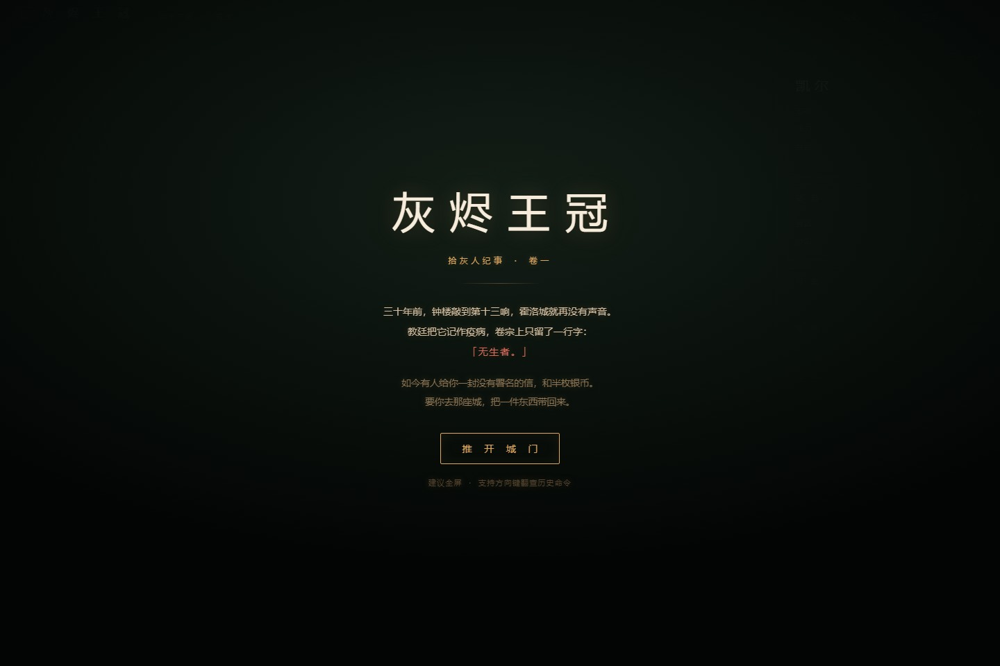
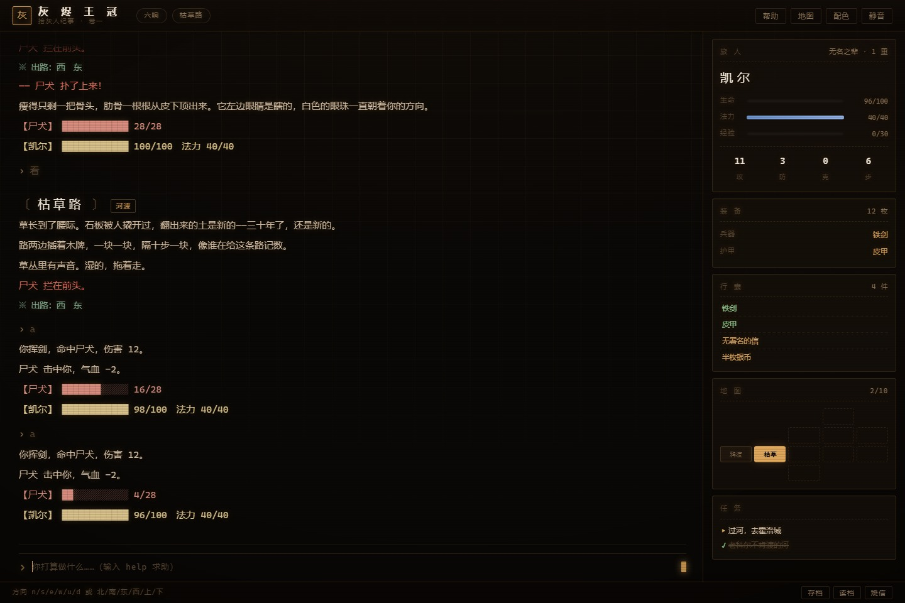
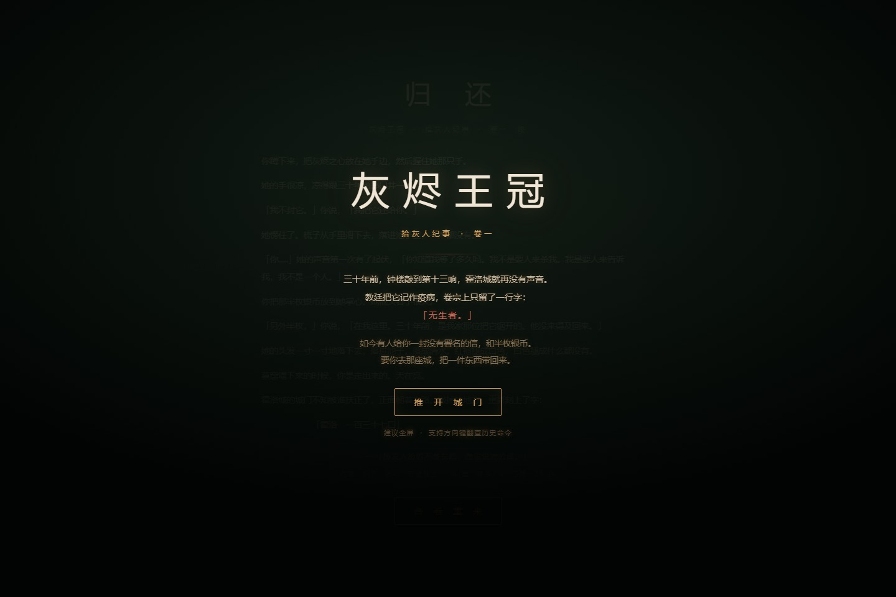

# 灰烬王冠 · 拾灰人纪事

> 三十年前，钟楼敲到第十三响，霍洛城就再没有声音。
> 教廷把它记作疫病，卷宗上只留了一行字：**「无生者。」**

一个西幻黑暗哥特风格的**文字 MUD**。纯前端、零依赖、零构建，双击 `index.html` 即玩。


**[▶ 在线试玩](https://3cancanneed.github.io/ashcrown-mud/)** ｜ 或者下载后双击 `index.html`



---

## 玩什么

你是**凯尔·凡恩**，一个拾灰人——替死人收尸，也替死人跑腿。

有人给你一封没有署名的信、半枚银币，叫你去霍洛城，把一件不该被找回来的东西带回来。

城里有十一个地方：鸦渡、枯草路、灰门口、圣阿黛拉小堂、枯井、停尸房、白桦林、墓窟阶梯、圣器厅、钟底大厅，以及一处没有光的所在。

路上有尸犬、石像鬼、稻草人、亡灵战士、守钟人。最深处坐着**灰烬圣女**，她梳了三十年的头，就等一个人看。

**四个结局**，其中一个是隐藏的——需要你把这城的故事一片片拼齐，才答得出最后那句话。



## 怎么玩

在底部输入框敲命令，回车。方向键可翻历史，`Tab` 补全，点「出路」按钮也能走。

| 指令 | 作用 |
| --- | --- |
| `看` / `look` | 看看四周；`看 城徽` 可细看某物 |
| `走 北` / `n` | 朝某方向走（`n s e w u d` 或 `北南东西上下`） |
| `拿 剑` / `take` | 拾起地上的东西 |
| `用 药水` / `use` | 喝药；`读 信` 可展信 |
| `装备 剑` / `穿 袍` | 换兵器与护甲 |
| `打 尸犬` / `attack` | 动手 |
| `说话 老人` / `talk` | 与人对谈，多谈几次话会不一样 |
| `买` / `卖` / `list` | 行商处交易 |
| `休息` / `rest` | 只在小堂可行，回满气血法力 |
| `背包` `属性` `技能` `任务` | 查看自身 |
| `地图` `存档` `读档` | 地图与存读 |

**战斗**是回合制：`a` 普攻、`1`–`5` 出招、`用 药水`、`f` 逃。
打法不止一种——高攻速杀、先手侧步、残血嗑药，都能过。

## 内容

- 11 个房间，含一扇需要钥匙的井门、两处必须点火的暗室
- 6 种敌人与 1 个 Boss
- 3 个可交谈的角色（其中一个是行商）
- 5 式技艺、6 件装备、6 种消耗品
- 4 个结局 + 1 条隐藏线索链
- 存档走 `localStorage`，关掉浏览器也在

## 文件

```
灰烬王冠/
├── index.html          结构（开场幕布、日志、侧栏、底栏）
├── css/style.css       CRT 磷光终端风，三套配色
└── js/
    ├── data.js         全部内容：房间、物品、敌人、对话、结局
    ├── engine.js       解析命令、推进状态、结算战斗
    └── main.js         渲染、按键、存档、结局层
```

约 2900 行，没有框架，没有 npm，没有构建步骤。

## 技术笔记

- **不用 ES module**：`file://` 下 `type="module"` 会被 CORS 拦死，普通 `<script src>` 才能双击打开。所以三个脚本靠 `window.DATA` / `window.Game` 通信。
- **一切内容都在 `data.js`**：加一个房间、一件物品、一个敌人，只改这一个文件。
- **中文宽度对齐**：日志里的地图与表格用 CSS Grid 排版，不靠空格凑——等宽中文字形宽度未必是半角的整两倍。
- **战斗与叙事同一个事件流**：引擎产出事件数组，界面只负责把它渲染成字。

## 部署到 GitHub Pages

仓库已经配好，只需三步：

1. 在 GitHub 上新建空仓库 `ashcrown-mud`（不要勾 README / .gitignore / license）
2. `git push -u origin main`
3. 仓库 **Settings → Pages** → Source 选 `Deploy from a branch`，Branch 选 `main` + `/ (root)`

一两分钟后访问 `https://3cancanneed.github.io/ashcrown-mud/`。

## 姊妹作

同引擎还有一个中式志怪版本：**《归墟 · 拾遗人纪事》**——长夜渡、乌斯村、血池地宫，四个结局。

## 许可

MIT。随便玩，随便改。

---


